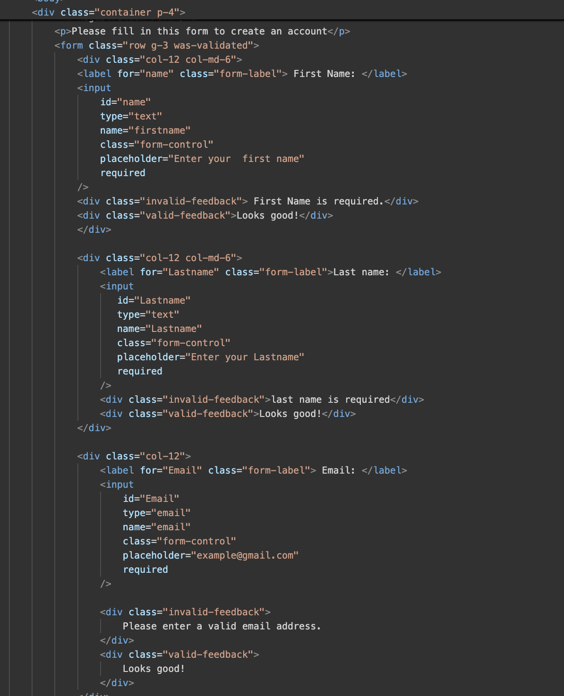
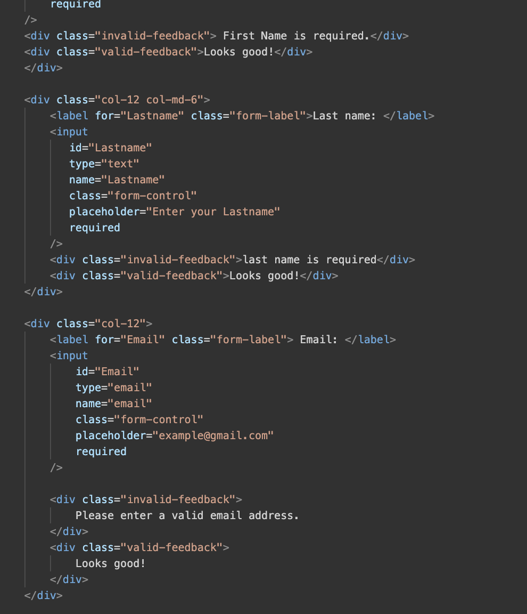
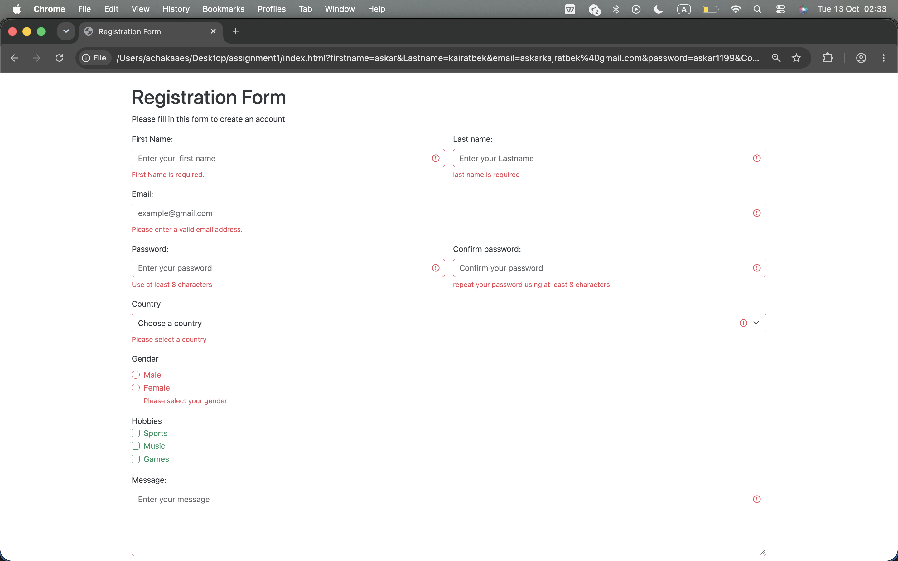

# assignment4
## Name: Askar Kairatbek  
## Group: IT-2501

## Part 1 - basic html forms
### task 0:
The contact form has Name, Email, Message, and a Submit button.
Each field has a label.

### Task 1: HTML Validation

I used `required` to make fields mandatory.
The email field uses `type="email"` to check the email format.
Length limits control the number of characters.

## Part 2 - bootsrap forms

### task 2: Bootstrap form styling
I used Bootstrap to style the fields and buttons.
I used `row` and `col` classes to arrange the fields.
The layout changes depending on the screen size.

## Task 3: Validation Feedback

The form shows error messages for invalid information.
It shows “Looks good!” for valid information.

## Part 3 - Advanced form Project

### Task 4: Registration form
My registration form includes:
- First Name and Last Name
- Email
- Password and Confirm Password
- Gender radio buttons
- Hobbies checkboxes
- Country dropdown
- Submit and Reset buttons

Passwords must contain at least 8 characters. Radio buttons allow one choice. Checkboxes allow multiple choices.
Reset returns the fields to their initial values.

My form uses HTML validation and Bootstrap styling. It does not check whether the two passwords match.
It does not create a real account.

## Work Summary

I created the fields with HTML and styled them with Bootstrap. And I added validation rules and feedback messages. 
I learned how to use different form controls and the Bootstrap grid.

