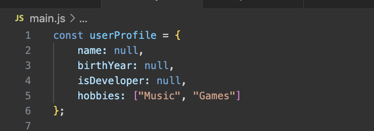
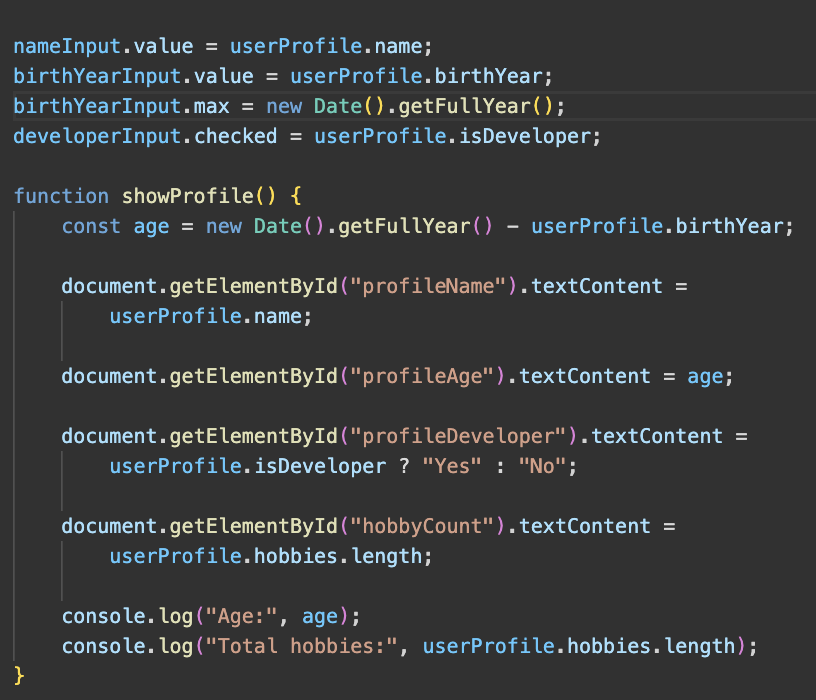
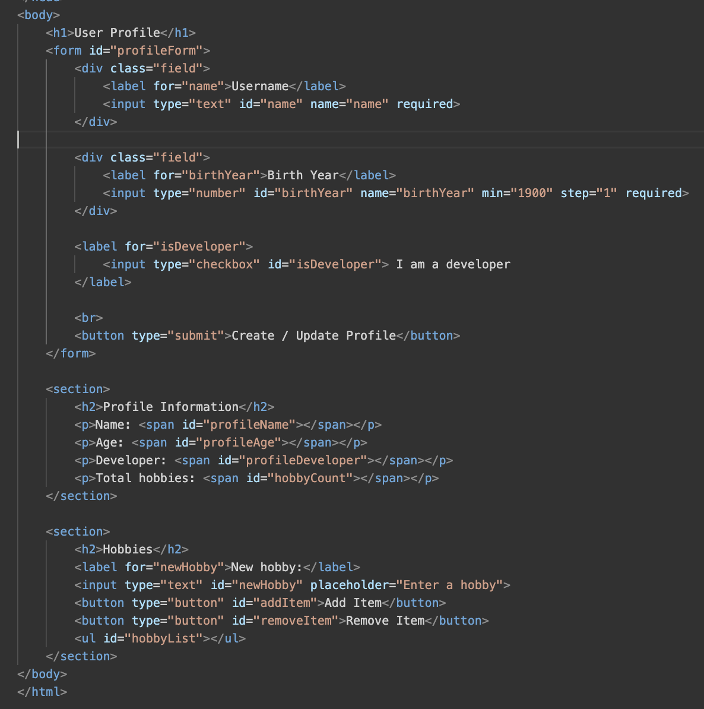
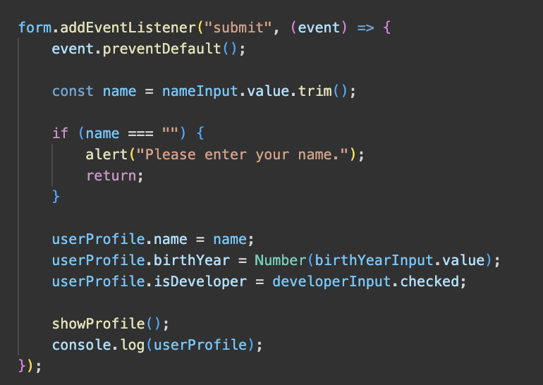
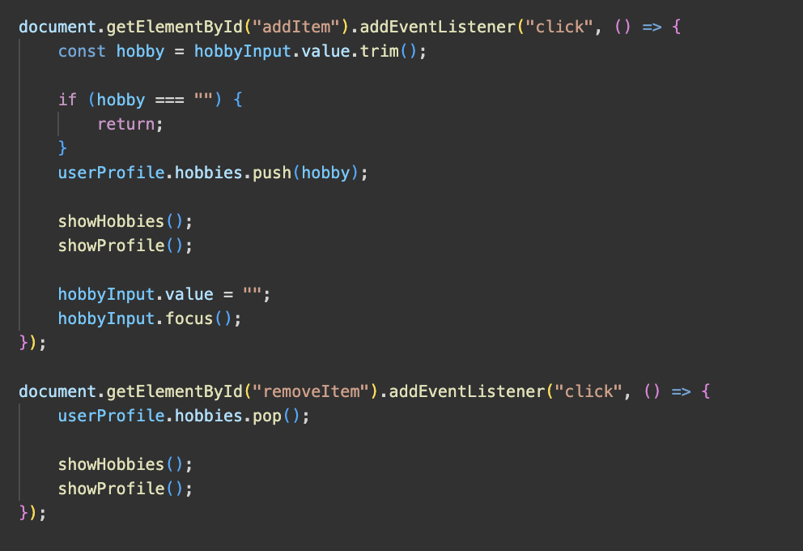
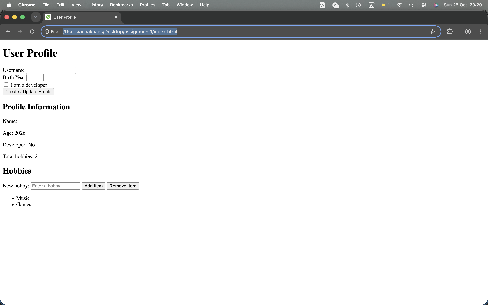

# assignment5
## Name: Askar Kairatbek  
## Group: IT-2501

## task 1
I created a const object called userProfile with four properties:

- name — a string.
- birthYear — a number.
- isDeveloper — a boolean.
- hobbies — an array.

## task 2
The program calculates the user's age by subtracting the birth year
from the current year.
It also counts hobbies using the array's length property.
Both values appear on the page and in the console.
The age calculation uses only the birth year, not the exact birthday.

## task 3
The form contains:
- A Username input.
- A Birth Year input.
- An "I am a developer" checkbox.
- A "Create / Update Profile" button.

## task 4
The form uses a submit event listener.
When the user submits the form, the program:

1. Prevents the page from reloading with preventDefault()
2. Reads the input values
3. Updates the userProfile object
4. Displays the updated profile

## Task 5: Creating and Removing Elements

Hobbies appear in an unordered list.

The "Add Item" button adds a hobby to the array.
The program uses createElement() and appendChild() to display list items
The "Remove Item" button removes the last hobby using pop()
The list and hobby count update after each change

Empty hobbies are not added, and removing from an empty list does not cause an error.

## Work Process Summary

So, I created the HTML form and added CSS styles.
Then I created the profile object and age calculation.
Finally, I added event listeners for updating the profile and managing the hobbies list.

https://achaka119.github.io/assignment4/
